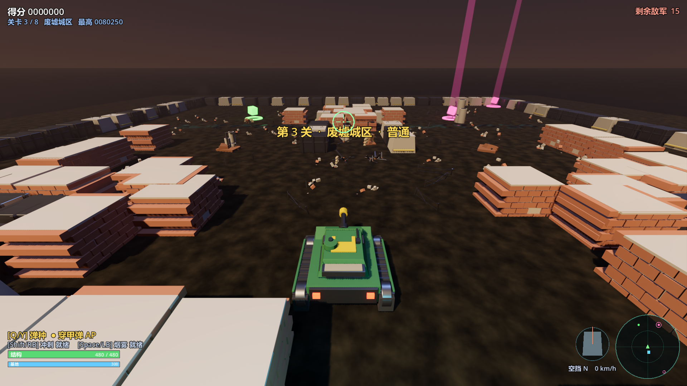
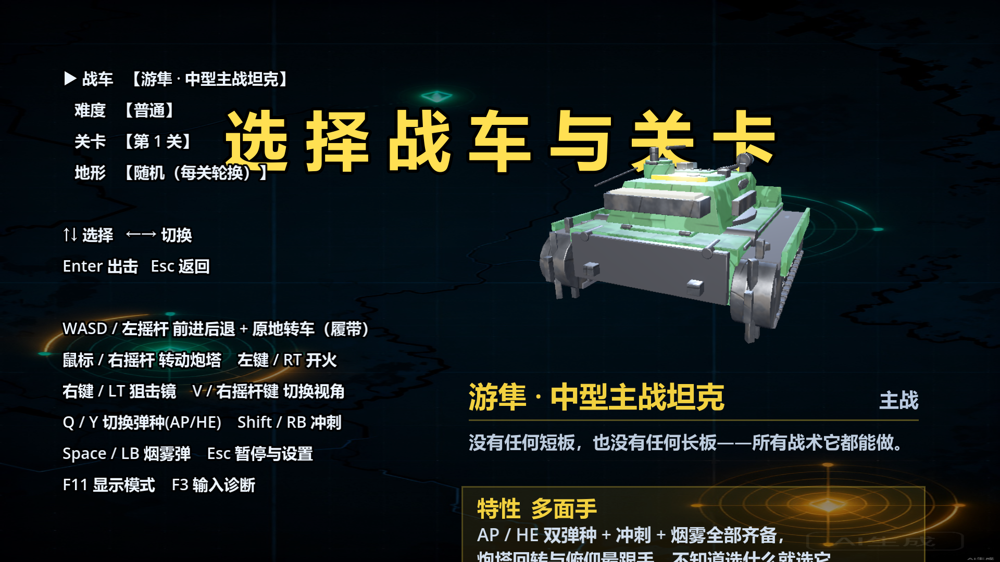
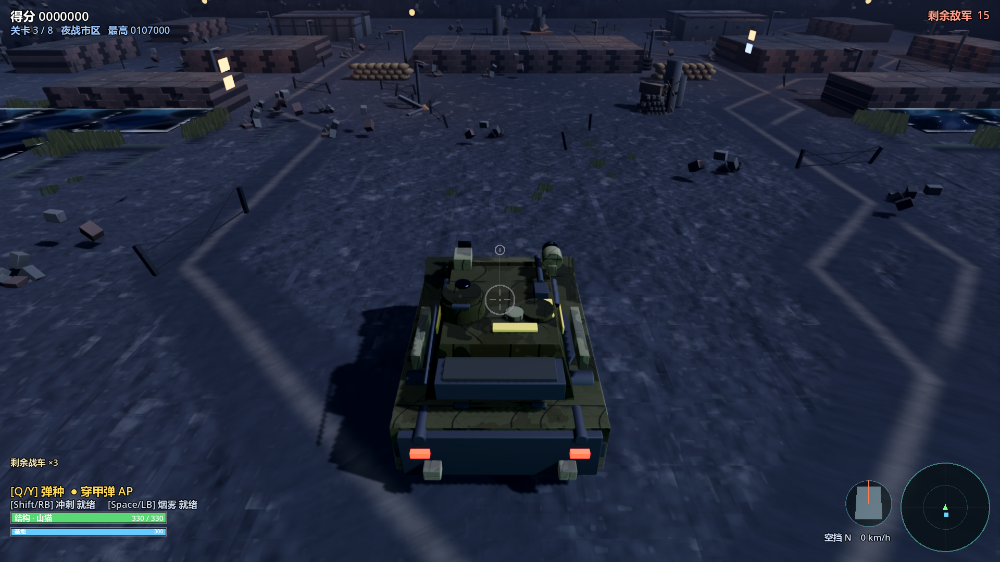

<div align="center">

# 坦克大战 3D · Tank Battle 3D

**第三人称 3D 坦克对战 · Godot 4.7 · GDScript**

车体与炮塔分离操控 · 装甲分区与跳弹 · AP/HE 双弹种 · A\* 寻路 AI · 8 关波次推进




</div>

---

## 目录

- [项目简介](#项目简介)
- [游戏截图](#游戏截图)
- [核心特色](#核心特色)
- [快速开始](#快速开始)
- [操作说明](#操作说明)
- [可选战车](#可选战车)
- [敌人与关卡](#敌人与关卡)
- [战场地形](#战场地形)
- [核心机制](#核心机制)
- [补给道具](#补给道具)
- [项目结构](#项目结构)
- [技术设计](#技术设计)
- [资源管线](#资源管线)
- [开发与验收](#开发与验收)
- [构建发布](#构建发布)
- [常见问题](#常见问题)
- [更多文档](#更多文档)

---

## 项目简介

这是一个使用 **Godot 4.7 + GDScript** 从零实现的第三人称 3D 坦克对战游戏。玩家驾驶五款定位不同的战车，在十二张程序化生成的战场中守住基地、歼灭八关波次敌人，并在第 4 关与第 8 关迎战 Boss。

项目的核心特点是把「坦克对战」拆成一组可以被单独验证的系统：

- **车体与炮塔分离操控**：车体有起步、刹车、倒车与撞墙掉速，炮塔独立回转，炮管独立俯仰。
- **装甲不是一块血条**：正面 / 侧面 / 背面三档伤害倍率，正面斜摆时 AP 弹有概率跳弹。
- **两种弹道规则**：AP 是 250 m/s 的直线弹，HE 是 112 m/s 的抛物线弹，发射方向由弹道解算得出。
- **敌人真的在走路**：A\* 网格寻路、四态行为机、提前量预瞄、卡死检测与绕行。
- **地图可破坏**：砖墙有独立血量，HE 可以成片铲平掩体；钢墙挡车也挡弹（不可破坏），水面与路障只挡车不挡弹。
- **全部内容可程序化重建**：除唯一的 `Main.tscn` 外，所有节点在运行时用代码构建；音效、粒子贴图、贴花、地面与水材质全部程序化生成；27 个 GLB 模型由 Blender Python 脚本一键重建。

> 完整的设计规格、数值来源与验收判据在 [`PROMPT.md`](PROMPT.md)。那份文档是项目的「唯一规格说明」，本 README 是面向玩家与开发者的入口。

---

## 游戏截图

| 车库：选择战车与关卡 | 夜战市区 |
| :---: | :---: |
|  |  |

车库右侧是一台独立 `SubViewport` 渲染的 3D 转台。切车会整个重建模型，属性卡与六条对比条同步刷新；左侧操作说明会按栏宽自动收字号，保证每一行都排得下。

---

## 核心特色

### 操控与手感

- **车体惯性模型**：起步加速度 14 m/s²、刹车减速度 26 m/s²、倒车速度上限 55%；原地转向保持满舵，拧舵只改朝向，不把车身硬塞进墙里。
- **撞墙反馈**：正面撞墙明显掉速，擦墙滑行只损失一点速度。
- **炮塔跟手**：炮塔回转带「大角度加速」——甩炮时转得快，临门微调仍然稳。
- **俯仰范围 `-18° ~ +6°`**：下限是几何量（近距离压炮），上限是手感量。俯仰不做平滑，避免「甩炮即射」时炮弹沿着还没压下去的炮管飞出去。
- **点击必出弹**：装填压到 0.05~0.09 s，点一下左键当帧击发；按住左键则以 0.22 s 的间隔持续射击，不会变成机枪。
- **近战辅助**：两台车贴到 3~5 m 时，准星压在敌车任何可见部位都能打中车体；同时把炮塔残差在开火帧吃掉，避免近距离甩炮打空。
- **车体有重量**：加减速俯仰、转弯侧倾、开炮后坐、撞墙点头——只作用于视觉节点，物理层不动；诱导轮 / 主动轮 / 托带轮按半径比滚动，原地转向时左右履带反向转。
- **手柄完整支持**：左摇杆驾驶、右摇杆转塔、RT 开火、LT 狙击、LB 烟雾、RB 冲刺、Y 切弹、Start 暂停。

### 战斗可读性

- **敌车头顶血条**：投影到屏幕上绘制，Boss 加粗带名字，墙后不画，远处渐淡。
- **准星读装甲**：准星压在敌车上时按正面 / 侧面 / 背面变黄 / 橙 / 红，可能跳弹的角度加冷色描边。
- **四种结果各有反馈**：击穿、跳弹、击毁、格挡各有专属音色 + 准星下方短提示；敌弹被跳弹或被护盾吸收时也有方向环与提示。
- **击毁信息栏**：右上角「山猫 击毁 重型」，5 秒后淡出。
- **受击暗角**：被击中时屏幕边缘压红，血量低于 25% 时持续搏动。
- **详细结算与持久战绩**：伤害输出、挡下伤害、命中率、跳弹、最高连击、勋章；按车型与难度写入 `user://stats.cfg`，车库属性卡显示历史战绩。

### 隐蔽与烟幕

- **草丛隐蔽**：站在灌木 / 芦苇里，敌人 20 m 外看不见；开火后 1.6 s 内失效。
- **烟幕按云团生效**：半径 5.6 m，开出烟团立即重新暴露，不再是一张跟着车走的隐身符。
- **被发现指示灯**：中上方显示「被发现 / 烟幕隐蔽 / 隐蔽中」，判定与 AI 视通同源。
- **碾倒栅栏**：铁丝网 / 栅栏被坦克压过时倒伏（纯视觉，本来就不挡车）。

### 战斗规则

- **三档装甲分区**：入射角 `<55°` 为正面、`55°~125°` 为侧面、`>125°` 为背面，各自使用独立伤害倍率。
- **跳弹**：仅「正面 + AP 弹 + 入射角 >32°」时，有 30% 概率跳弹、零伤害。正面迎敌时把车体斜着摆是有收益的操作。
- **AP / HE 双弹种**：AP 直线飞行、只破当前格；HE 抛物线飞行、直击伤害 ×0.72、7 m 溅射、成片清砖墙并留下弹坑。
- **HE 弹道解算**：按准星实际落点解一条低抛弹道，而不是给炮管加一个固定上抬角；解算上限 11°，超出或无落点时退回平直发射。
- **炮塔命中体**：车体命中圆柱只有 2 m 高，炮塔另有一个独立圆柱命中体，所以「准星压在炮塔上」不会从车顶飞过去。
- **部位反馈**：命中时飘出「正面 57」「跳弹!」「溅射 23」等文字，HUD 的受击方向环指示来袭方向。

### 敌人 AI

- **四态行为机**：`SEEK` 推进 / `ENGAGE` 对射 / `FLANK` 绕侧 / `RETREAT` 低血后撤。
- **网格寻路**：`AStarGrid2D` + 八方向移动，路径点进入 0.7 格即出队；1.1 s 内位移不足 0.35 m 判定卡死并倒车绕行。
- **视线判定**：按 1.6 m 步长在网格上步进，不使用物理射线——与 AI 的格子世界观一致，也更便宜。
- **提前量预瞄**：按弹速计算飞行时间，再乘难度系数；HE 的抬升量不在这里补，由 `Tank.fire()` 统一解算。
- **失去视野后转攻基地**：保留「守家」压力，不会因为玩家绕后就把基地忘掉。
- **掩体与探头**：装填期间退到能挡住视线的砖墙后，装填完探出 4~8 m 打一发再缩回；重型车与 Boss 斜摆车身迎弹。
- **残骸入寻路**：击毁后的残骸写进 A\* 网格，敌人从远处绕开而不是顶上去倒车。
- **难度不靠堆数量**：三档难度只调整散布、反应延迟、提前量系数与 HP/伤害/装填乘数。

### 关卡与战场

- **8 个关卡**、3 档难度、3 条命。
- **12 张地形**，每张左右镜像对称，保证双方公平；同一局不会重复，不同局之间轮换走遍。
- **程序化布局 + 连通性兜底**：出生走廊、玩家活动区、基地进出口固定挖空；每张图生成后跑 A\* 验证所有出生点都能到达基地，路障落子后再次泛洪复验。
- **可破坏掩体**：砖墙 60 HP，低于 50% 换受损模型；钢墙不可破坏但挡弹；水面与路障挡车不挡弹，形成「能打不能过」的对射走廊。
- **破坏留在场上**：打碎的砖墙留下 2~3 块碎砖与焦痕；AP 打地留小弹坑与土溅，HE 留更大的坑；炮弹落水有水柱与涟漪。
- **道具会被打到**：炮弹对路障、残骸、沙袋做一次额外的视觉射线检测，出火花 / 木屑 / 沙尘，但「挡车不挡弹」的规则不变。
- **基地防守**：基地两格、300 HP，血量归零立即判负，不管还剩几条命。

### 表现与可读性

- **手绘 HUD**：得分、连击、剩余敌军、结构条、基地条、弹种、技能冷却、雷达、车体朝向盘、准星与装填环、炮口真实指向、受击方向环、敌车血条、击毁信息栏、隐蔽指示灯，全部用 `Control._draw()` 绘制，不依赖任何 `.tscn` 或 Theme。
- **雷达随车头旋转**：上方永远是车头方向；火炮用紫色、Boss 用橙色并画得更大。
- **十二张地形有光照可读性下限**：敌车像素平均亮度 `enemyLum ≥ 0.20`、整帧平均亮度 `sceneLum ≥ 0.15`，由 `tools/vis_probe.gd` 逐张验收。
- **程序化音频**：44100 Hz 单声道合成，炮声按口径分档，击穿 / 跳弹 / 击毁 / 格挡各有专属音色；爆炸、碎砖、拾取、警报、胜负音全部由扫频与低通噪声拼出；发动机循环音保证首尾相位连续。
- **程序化特效**：火球、冲击波、炮口焰、跳弹火花、碎块、烟幕、伤害飘字，粒子贴图也是运行时生成。
- **战场痕迹**：烧灼痕、HE 弹坑、履带印走 `Decal` 池，一局打下来地面会被慢慢犁一遍；弹坑有独立的凹坑法线，履带印是左右两条链节带而不是一块糊斑。
- **击毁后留残骸**：被打掉的车不再直接消失，而是变成焦黑残骸（炮塔歪斜、炮管下垂、冒烟 30 秒），碰撞体挡车不挡弹，既是视觉焦点也是掩体。
- **坦克是“活的”**：履带按真实线速度滚动 UV，诱导轮 / 主动轮 / 托带轮按半径比转动；起步抬头、刹车点头、转弯侧倾、开炮后坐、撞墙点头；移动时车尾扬尘、发动机排气、结构低于 45% 时冒黑烟。

### 视觉改造

这一轮把画面从「桌面沙盘」往「战场」推，改动集中在尺度、材质分层与战场叙事三处，玩法参数没有动：

- **相机压低**：俯视点从 5 m 降到 2.35 m，弹簧臂 12 → 7.6 m，垂直 FOV 74° → 60°，俯角 26° → 18°。坦克占屏高度从约 24% 提到 44% 以上（`tools/framing_probe.gd` 实测十二张图最差 0.438），3 m 砖墙第一次真正挡住视线；俯视时占满画面的墙顶压顶石降到 8% 以下（实测最差 0.078）。
- **天空与远景**：自定义天空 shader 画太阳/月亮盘、fbm 云层与星场；两圈低模山脊替代「地面平面切到天空」的硬边，雾把接缝吃掉。
- **地面不再是噪声纸板**：世界坐标混合土/碎石/草三套颜色，大尺度明度打散重复，法线由高度场解析求出；基地到三条进攻线的土路带两道车辙，复用 A\* 路径所以不会画进墙里。
- **墙体拼成一堵墙**：`BLOCK_FIT` 3.84 → 3.97，允许模型向上放大 3.5%，4 m 格内的拼缝从 16 cm 收到 3 cm 以内；4 m 一块的亮色压顶板改成 3×3 块有缝、有高低的深色压顶石；同类墙格的接缝上再补竖向壁柱，12 m 的墙不再读成三块积木。
- **坦克材质三层信息**：涂装 shader 叠世界高度泥污、顶点色 AO 与低频流痕，并加冷色菲涅耳边缘光；履带 UV 滚动、侧裙分三段露出负重轮、炮塔识别色改成窄条、帆布压暗到脏橄榄色。
- **水岸**：沿临岸边缘生成会呼吸的泡沫带，岸上压一条湿泥（带藻绿），临岸一格长芦苇。整片水网只多三次 draw call。
- **道具与植被**：重型道具开阴影；路障按「被击毁的车队 / 哨卡 / 维修点」成组摆放；新增轮胎堆、木板堆、倒伏电线杆；空地铺草簇、墙根长灌木，草色按地形压暗，不再是一片荧光绿。
- **夜战不再只是「把白天调暗」**：沿街生成带真实碰撞与暖色光池的路灯，临街立面补暖/冷两色自发光窗口（两次 draw call），地面反照率从偏蓝收到中性灰，冷色只留给月光与天空。
- **爆炸残留**：贴地尘环停留 2.6 秒，碎块落地后真的留在原地一段时间；HE 弹坑贴花带凹陷法线。
- **车库转台**：程序化天空作反射源、主光开阴影、接影地面、ACES 色调映射，预览分辨率 760×440 → 1200×700 并开 4× MSAA。

可量化验收有三条线：

- `tools/vis_probe.gd`：十二张图的敌车亮度 `enemyLum ≥ 0.20` 与整帧亮度 `sceneLum ≥ 0.15`，当前 12/12 通过。
- `tools/framing_probe.gd`：坦克占屏高度 `≥ 0.35`、墙顶压顶石像素占比 `≤ 0.10`，当前最差 0.438 / 0.078。
- `tools/combat_probe.gd`：十二张图各跑 2400 帧，回归穿墙与 AI 死锁。

---

## 快速开始

### 环境要求

| 项 | 要求 |
| --- | --- |
| 引擎 | **Godot 4.7**（Forward+ 渲染后端） |
| 语言 | GDScript，静态类型 |
| 第三方插件 | 无 |
| 操作系统 | Windows / Linux / macOS 均可运行；仓库内导出预设为 Windows Desktop |
| 显卡 | 支持 Forward+ 的桌面 GPU；低画质档位可关闭大部分屏幕空间效果 |

### 运行

1. 安装 [Godot 4.7](https://godotengine.org/download)。
2. 用 Godot 打开本目录下的 `project.godot`。
3. 按 `F5` 运行，或在项目根目录执行：

```bash
godot --path .
```

打开编辑器：

```bash
godot --editor --path .
```

> 仓库里的 `.vscode/settings.json` 与 `.vscode/tasks.json` 写死了本机的 Godot 路径（`D:\DevSoftware\godot\godot.exe`）。换机器后请把 `godotTools.editorPath.godot4` 和 `tasks.json` 里的 `GODOT` 环境变量改成自己的路径。

首次打开时 Godot 会导入 `assets/models` 下的 GLB 与贴图，需要等待几十秒。导入完成后直接运行即可。

---

## 操作说明

### 战斗

| 操作 | 键盘 / 鼠标 | 手柄 |
| --- | --- | --- |
| 前进 / 后退 | `W` `S` / `↑` `↓` | 左摇杆 Y |
| 转向 | `A` `D` / `←` `→` | 左摇杆 X |
| 转动炮塔 | 鼠标移动 | 右摇杆 |
| 开火 | 鼠标左键 | `RT` |
| 狙击镜 | 鼠标右键 | `LT` |
| 切换弹种 AP / HE | `Q` / `1` / `2` | `Y` |
| 冲刺 | `Shift` | `RB` |
| 烟雾弹 | `Space` | `LB` |
| 切换第一 / 第三人称 | `V` | 右摇杆按下 |
| 暂停与设置 | `Esc` | `Start` |
| 切换显示模式 | `F11` | — |
| 输入诊断 | `F3` | — |
| 重新出击（结算界面） | `R` | `X` |
| 返回标题（菜单 / 暂停） | `Q` | `B` |

### 菜单

| 操作 | 按键 |
| --- | --- |
| 上下选择 | `W` `S` / `↑` `↓` |
| 左右切换 | `A` `D` / `←` `→` |
| 确认 / 出击 | `Enter` |
| 返回 | `Esc` |

驾驶方式有两套，可在暂停菜单的「驾驶方式」里切换：

- **镜头相对**：`WASD` 按画面方向行驶，单独按 `A` / `D` 原地转车；
- **履带转向**：传统坦克操作，`A` / `D` 控制左右履带转向。

---

## 可选战车

五台车不是简单的数值皮肤。每台车都有两组差异：一组是火力 / 装甲 / 机动的取舍，决定「选谁」；另一组是一条行为特性，决定「怎么玩」。

| 车型 | 定位 | HP | 速度 | 装填 | 单发伤害 | 前 / 侧 / 后受击倍率 | 特性 |
| --- | --- | ---: | ---: | ---: | ---: | --- | --- |
| **山猫** `lynx` | 侦察 | 330 | 19.5 m/s | 0.05 s | 62 | 90% / 115% / 160% | 冲刺 3.0 s、冷却 6 s；烟雾冷却 15 s。靠机动活命 |
| **游隼** `falcon` | 主战 | 480 | 15.0 m/s | 0.06 s | 115 | 50% / 100% / 170% | AP / HE 双弹种 + 冲刺 + 烟雾全部齐备，默认车 |
| **铁砧** `anvil` | 突破 | 760 | 11.2 m/s | 0.08 s | 165 | 32% / 85% / 155% | 正面近乎免疫 AP；车体 3.8 m 宽，窄通道转向迟滞 |
| **雷锤** `thunder` | 支援 | 350 | 12.5 m/s | 0.09 s | 118 | 75% / 125% / 185% | HE 伤害 ×1.45、溅射半径 ×1.35；装甲最脆、装填最慢 |
| **猎手** `hunter` | 歼击 | 400 | 13.5 m/s | 0.07 s | 190 | 30% / 95% / 170% | 炮塔只能左右各转 40°，射界外必须用车体指向目标 |

补充说明：

- 受击倍率**越小越硬**。玩家基准比敌人更硬，因为玩家只有一辆车，而敌人有半打。
- 装填时间是「点击手感量」而不是火力旋钮：五台车都压到玩家感觉不到等待，彼此强弱由伤害、装甲、机动决定。
- 猎手的炮塔限位会**夹住目标角**而不是否决输入：炮塔走到限位就停住，准星染成橙色。玩家看到的是「炮塔到边了」，而不是「鼠标失灵」。
- 选车结果写入 `user://settings.cfg` 的 `game/selected_tank`，下次启动仍停在上一次那台车上。

---

## 敌人与关卡

### 敌人类型

| 类型 | HP | 速度 | 装填 | 伤害 | 分数 | 偏好距离 | 备注 |
| --- | ---: | ---: | ---: | ---: | ---: | ---: | --- |
| 侦察 | 150 | 17.0 | 1.9 s | 45 | 100 | 13 m | 最快、最脆，负责骚扰 |
| 中型 | 280 | 12.5 | 2.6 s | 70 | 200 | 20 m | 标准对射单位 |
| 重型 | 450 | 8.5 | 3.6 s | 110 | 400 | 16 m | 正面装甲厚，低血不后撤 |
| 火炮 | 170 | 9.5 | 4.4 s | 130 | 500 | 40 m | 默认 HE，远程曲射 |
| Boss | 1100 | 8.0 | 1.9 s | 130 | 2000 | 22 m | 车体放大，第 4 / 8 关压轴 |

每关在上表基础上成长：`HP × (1 + min(stage-1, 7) × 9%)`、`伤害 × (1 + min(stage-1, 7) × 5%)`。

### 关卡流程

```
标题 → 选择战车与关卡 → 2.6 s 倒计时 → 战斗
战斗 → 全歼敌人 → 过关结算 → 下一关 / 第 8 关通关
战斗 → 三命耗尽 或 基地被毁 → 失败结算
```

| 参数 | 规则 |
| --- | --- |
| 总关数 | 8 |
| 生命数 | 3，死亡后 2.5 s 重生，重生带 3 s 护盾 |
| 每关敌人总量 | `min(26, 9 + stage × 2)` |
| 同屏敌人上限 | `min(2 + stage / 2, 6)` |
| 出怪间隔 | 普通 1.4 s，Boss 2.6 s |
| Boss 关 | 第 4 关、第 8 关波次末尾追加一台 |
| 出生点 | 5 个固定点，优先选 8 m 内无坦克的位置 |
| 过关奖励 | `1000 + stage × 250` |
| 通关奖励 | 剩余命数 × 3000 |
| 击毁得分 | 车型分数 × 连击倍率 |
| 连击 | 4.5 s 窗口，每次击毁 +0.5，上限 ×5.0；被击中立即归零 |

---

## 战场地形

十二张地形各有独立的掩体布局与光照色调，但共用同一套生成兜底：最外圈钢墙、基地砖墙、出生走廊与玩家活动区固定挖空、A\* 连通性校验、路障落子后泛洪复验。

| # | 地形 | 布局特征 |
| --- | --- | --- |
| 1 | 废墟城区 `ruins` | 成团掩体 + 横向水带，节奏最均衡，默认战场 |
| 2 | 要塞回廊 `fortress` | 三条纵向长墙切出平行通道，横向短墙切断过长走廊 |
| 3 | 河谷渡口 `valley` | 2~3 条横向水带，每条只开两处镜像渡口 |
| 4 | 迷宫街区 `maze` | 3 格间距的横竖细墙网，外圈保留环形外道 |
| 5 | 开阔荒原 `badlands` | 极少大块掩体 + 一池死水，远距离机动战 |
| 6 | 雪原哨所 `snow` | 圆形冰湖 + 零散掩体，通路被湖面挤窄 |
| 7 | 工业港区 `docks` | 纵向钢制船坞 + 纵向水道 + 货箱堆，交战距离最短 |
| 8 | 熔岩弹坑 `crater` | 三圈同心环形掩体，每圈只开两个错开缺口，中央熔池 |
| 9 | 丛林小径 `jungle` | 45° 斜向短墙网 + 林间水洼，视野最碎 |
| 10 | 夜战市区 `night` | 2×2 街块按 4 格间距排布，街道必然贯通 |
| 11 | 沙漠风暴 `desert` | 斜向沙垄 + 岩堆 + 小片绿洲 |
| 12 | 铁路枢纽 `rail` | 三排纵向车厢夹站台，横向检修道切断纵向通路 |

> 地图左右镜像对称。种子由 `stage` 与 `terrain` 共同决定，所以「同一关换张图」不会生成出同样的掩体分布。

---

## 核心机制

### 装甲分区与跳弹

命中时取入射方向与车体正面（`-basis.z`）的水平夹角：

| 夹角 | 区域 | 说明 |
| --- | --- | --- |
| `< 55°` | 正面 | 使用 `armor_front` 倍率 |
| `55° ~ 125°` | 侧面 | 使用 `armor_side` 倍率 |
| `> 125°` | 背面 | 使用 `armor_rear` 倍率 |

跳弹条件：**正面 + AP 弹 + 入射角 >32°**，30% 概率跳弹、零伤害。附加装甲增益期间，最终倍率再 ×0.6。

### AP / HE 弹种

| | AP 穿甲弹 | HE 高爆弹 |
| --- | --- | --- |
| 初速 | 250 m/s | 112 m/s |
| 弹道 | 直线，不受重力 | 抛物线，受 34 m/s² 重力 |
| 伤害 | `shooter.damage` | 直击 ×0.72 |
| 命中掩体 | 只破当前格 | 清半径内砖墙 |
| 命中坦克 | 可能跳弹 | 直击 + 7 m 溅射 |
| 溅射 | 无 | `dmg × 0.85 × (1 - 距离/7)`，不伤射手 |
| 留痕 | 无 | 弹坑贴花 |

HE 的发射方向由 `Shell.lob_dir()` 解算：

```
tanθ = (v² - sqrt(v⁴ - g(g·r² + 2·y·v²))) / (g·r)
```

取低抛分支，飞行时间最短。解算仰角上限 11°，超出射程或准星没有落点时退回平直发射。

### 炮弹飞行

炮弹不使用 `RigidBody3D` 或 `Area3D`，而是把每物理帧的位移切成不超过 1.2 m 的段，逐段 `intersect_ray`。原因是 250 m/s 在 120 Hz 下单帧位移约 2.08 m，形状检测会穿透薄墙。

### 敌人 AI 状态机

| 状态 | 触发条件 | 行为 |
| --- | --- | --- |
| `SEEK` | 看不见玩家，或血量恢复 | 沿 A\* 路径推进；看不到玩家时目标改为基地 |
| `ENGAGE` | 看得见玩家且距离合适 | 保持偏好距离对射，距离过近后退 |
| `FLANK` | 交战中每 3.5 s 有 35% 概率 | 绕目标做圆周机动，制造侧后装甲压力 |
| `RETREAT` | 血量 <28% 且非重型 / Boss | 朝背离目标 18 m 处撤退，仍然还击 |

AI 的难度差异集中在三处：散布 `[3.2, 1.9, 1.0]`、反应延迟 `[0.75, 0.45, 0.2] s`、提前量系数 `[0.35, 0.75, 1.0]`。

### 相机与 HUD

- 第三人称弹簧臂相机，常态 FOV 60°、臂长 7.6 m、俯视点离地 2.35 m；狙击镜 FOV 26°、臂长收到 0。
- 镜头俯仰跟随炮管仰角的 50%，既让准星在画面里上下移动，又不会把地平线甩出画面。
- 震屏按 `trauma²` 缩放，三个错开频率（47 / 39 / 53 Hz）避免规律感。
- 准星四根短线按装填进度张合；炮口真实指向用次级圆环标出，两者重合才是真的对准。
- 雷达量程 70 m，随车体朝向旋转，标记基地、补给、敌人、Boss 与自身。

### 程序化音频

采样率 44100 Hz、单声道 16-bit，最大同时发声 28。所有音效由两个合成器生成：

- `_tone(freq0, freq1, dur, vol, wave)`：扫频方波 / 正弦波；
- `_noise(dur, vol, cutoff)`：单极点低通白噪声；
- `_mix(a, b)`：叠加两段，得到更厚的声音。

发动机循环音由 45 Hz 基频与 2/3/4 次谐波组成。每个分量在循环时长内走过的周期数都取整，所以首尾相位连续，听不到循环接缝的咔哒声。

### 设置项

暂停菜单提供 17 项设置，调整后立即写入 `user://settings.cfg`：

| 分类 | 项目 |
| --- | --- |
| 显示 | 显示模式、分辨率、画质、渲染缩放、MSAA、TAA、垂直同步、帧率上限、界面缩放 |
| 画面 | 画面亮度（ACES 曝光补偿） |
| 音频 | 总音量、音效音量、发动机音量 |
| 输入 | 鼠标灵敏度、手柄灵敏度、鼠标 Y 轴反转、驾驶方式 |

显示模式支持「独占全屏 / 无边框全屏 / 窗口」三态，`F11` 循环切换并立即落盘。游戏启动时默认按显示器原生分辨率全屏，HUD 以 1920×1080 为设计空间等比缩放。

---

## 补给道具

普通敌人 34% 掉落，Boss 必掉；击杀掉落存在 22 秒。场上还会每 8~13 秒定时空投一次，最多同时存在 4 个，定时空投存在 38 秒。补给最后 5 秒闪烁提醒，拾取范围 3.4 m。

| 类型 | 名称 | 效果 |
| --- | --- | --- |
| `REPAIR` | 维修包 | 恢复 45% 结构 |
| `ARMOR` | 附加装甲 | 20 s 内受伤 −40% |
| `RAPID` | 快速装填 | 20 s 内装填提速 80% |
| `SHIELD` | 能量护盾 | 8 s 完全免伤 |
| `AIRSTRIKE` | 空中支援 | 全场敌人受 `max_hp × 0.7 + 60` 的 HE 伤害，从天顶入射、吃背面倍率 |
| `FORTIFY` | 基地加固 | 25 s 内基地砖墙换成钢墙 |
| `FIREPOWER` | 火力强化 | 本关伤害 +25%，可叠加 |
| `MULTISHOT` | 多弹装填 | 22 s 内每次击发额外发射左右各一发（±2.4° 散布） |
| `OVERDRIVE` | 引擎过载 | 20 s 内移动速度 ×1.35、转向 ×1.25 |

掉落池规则：

- **击杀掉落**：`REPAIR`×2、`RAPID`×2，以及 `ARMOR`、`SHIELD`、`FIREPOWER`、`MULTISHOT`、`OVERDRIVE`、`AIRSTRIKE`、`FORTIFY` 各一份。基地血量低于 50% 时额外追加 `FORTIFY` 与 `REPAIR`。
- **定时空投**：偏向直接提升战斗力的增益（`FIREPOWER` / `RAPID` / `MULTISHOT` / `OVERDRIVE` 各两份，`ARMOR` / `SHIELD` 各一份）。玩家血量低于 60% 时追加两份 `REPAIR`，基地血量低于 60% 时追加 `FORTIFY`。

---

## 项目结构

```text
tank-game/
├── project.godot                  # 引擎配置：autoload、显示、物理帧率、渲染默认值
├── scenes/
│   └── Main.tscn                  # 唯一场景：一个挂 main.gd 的 Node3D
├── scripts/                       # 约 13600 行 GDScript，18 个脚本
│   ├── main.gd                    # 主协调器：状态机、关卡、波次、计分、道具、菜单
│   ├── arena.gd                   # 战场：网格地形、可破坏掩体、基地、A*、视线、环境、贴花
│   ├── tank.gd                    # 坦克基类：驱动惯性、炮塔、装填、装甲分区、跳弹
│   ├── player.gd                  # 玩家坦克：输入轮询、冲刺/烟雾、隐蔽判定、发动机音
│   ├── enemy.gd                   # 敌人 AI：5 车型数值表 + 4 态状态机 + 掩体 / 预瞄
│   ├── shell.gd                   # 炮弹：分步射线、AP 直线 / HE 抛物线溅射
│   ├── camera_rig.gd              # 弹簧臂相机、两档狙击镜、震屏、准星射线查询
│   ├── hud.gd                     # 战斗 HUD，全部 Control._draw() 手绘
│   ├── tank_card.gd               # 车库属性卡与六条对比条
│   ├── tank_roster.gd             # 玩家可选战车名册（纯数据，无实体）
│   ├── powerup.gd                 # 空投补给：9 种增益、悬浮动画、拾取判定
│   ├── effects.gd                 # 粒子特效库（类名 Fx），全静态方法
│   ├── audio.gd       [autoload]  # 程序化音效合成与 2D / 3D 播放
│   ├── settings.gd    [autoload]  # 显示 / 画质 / 音量 / 灵敏度，读写 user://settings.cfg
│   ├── stats.gd       [autoload]  # 跨局战绩：伤害 / 格挡 / 命中率 / 击毁，读写 user://stats.cfg
│   ├── input_setup.gd             # 运行时注册全部输入动作（键鼠 + 手柄）
│   ├── assets.gd                  # 模型注册表，GLB 缺失时返回 null 触发图元回退
│   └── hull_guide.gd              # 车体朝向辅助
├── assets/
│   ├── models/                    # 27 个 GLB 与 Godot 抽取的贴图
│   └── bg/                        # 标题 / 选关背景
├── tools/
│   ├── blender/                   # Blender Python 生成器与尺寸真值表
│   ├── *.gd / *.tscn              # 冒烟测试、验收探针、截图工具（长期保留）
│   ├── _*.gd / _*.tscn            # 一次性调试探针（下划线前缀，由 .gitignore 排除）
│   └── build_assets.ps1           # 一键调用无头 Blender 重建全部 GLB
├── docs/screenshots/              # README 截图
├── export_presets.cfg             # Windows Desktop 导出预设
├── PROMPT.md                      # 完整设计规格与验收判据
└── README.md
```

`build/`、`tools/shots/`、根目录的调试日志与 `scripts/*.corrupt` 等临时文件已由 `.gitignore` 排除，不会进入仓库。

### 仓库约定

- **下划线前缀 = 一次性文件**：根目录和 `tools/` 下以 `_` 开头的截图、日志、转储、探针脚本由 `.gitignore` 排除。长期保留的工具与验收探针**不**使用下划线前缀。
- **不提交构建产物**：`build/`、`tools/shots/`、`*.exe`、`*.pck` 均已在 `.gitignore` 中。
- **事故恢复目录**：`_recover/` 只放临时抢救出来的文件副本（例如某次 `arena.gd` 损坏时的多个修复版本），确认无误后应删除，不入库。

---

## 技术设计

### 全代码构建，只有一个场景

`scenes/Main.tscn` 只包含一个挂了 `main.gd` 的 `Node3D`。战场、坦克、炮弹、HUD、相机、环境、菜单全部在运行时用 `new()` 构建。

这样做的直接收益：

- git diff 可读：所有参数都在代码里，不会出现「场景里改了一个值，但代码里还是旧的」；
- 参数集中：调手感只需要改常量，不需要在编辑器里翻节点；
- 可验收：探针可以直接实例化系统、读数值、跑物理帧，不依赖场景树的手工摆放。

### 物理与层级

| 项 | 设置 |
| --- | --- |
| 物理帧率 | 120 Hz |
| `layer_1` | `world`：地面、墙、基地 |
| `layer_2` | `tank`：坦克碰撞体 |
| `layer_3` | `tank_blocker`：路障（挡车、不挡弹） |
| 坦克碰撞体 | `CylinderShape3D`，半径 = 车体半径，高 2.0 m |
| 坦克运动 | `CharacterBody3D` + `MOTION_MODE_FLOATING` |

把物理帧率提到 120 Hz 是为了让炮弹的分步射线足够细、车体惯性积分足够稳。它也是炮塔跟随、近战压炮与「点击必出弹」这几套手感的共同底座。

### 尺寸真值表

模型尺寸、碰撞体半径、炮塔耳轴高度、炮口长度全部来自同一张表：

- Blender 侧：`tools/blender/dims.py`；
- Godot 侧：`scripts/tank_roster.gd` 的 `DIMS`。

两边必须逐项相等。改了一个数而忘了另一边，表现就是「车看起来开进了墙里」，而且是调物理参数永远修不掉的那种。

### 资源与可玩性解耦

`assets.gd` 在启动时扫描模型注册表。如果某个 GLB 缺失、节点层级不完整或材质命名不对，`Assets.instantiate()` 返回 `null`，坦克退回 `BoxMesh` / `CylinderMesh` 图元构建。

所以整个 `assets/models` 目录可以删掉，游戏仍能正常开局，只是观感回到图元时代。资源管线坏掉不应该让玩法停摆。

### 性能取舍

- 散布道具用 `MultiMeshInstance3D`，每种道具一次 draw call；
- 烧灼痕与履带印走 `Decal` 池，上限 90 / 160，超出回收最旧的一枚；
- 低画质档位关闭 SSAO、体积雾、glow、SSIL、SDFGI 与贴花，阴影降到 2 级、距离收到 120 m；
- 补光与曝光**不随画质关闭**：它们属于可读性，不属于画质。

---

## 资源管线

### 模型

全部 27 个 GLB 由 Blender Python 脚本生成，不使用任何下载素材：

| 脚本 | 产物 |
| --- | --- |
| `gen_tanks.py` | 7 台坦克：5 台玩家可选车 + 中型敌车 + Boss |
| `gen_walls.py` | 砖墙 3 变体 + 受损 3 态 + 钢墙 2 变体 + 水面 |
| `gen_base.py` | 指挥部碉堡 |
| `gen_props.py` | 10 种散布道具（沙袋、油桶、弹药箱、拒马、瓦砾、枯树、路灯、铁丝网、残骸、水泥管） |

模型节点契约必须保持 `Hull / Turret / Barrel / Muzzle`，另有 `Wheel_L0..n` / `Wheel_R0..n` 供滚动动画。材质命名同样有约定：`M_Paint` 与 `M_Accent` 会被阵营涂装覆写，其余材质保持 Blender 的 PBR 参数。

### 贴图

坦克贴图由 `lib_tex.py` 用 numpy 程序化生成，每组三张（albedo / normal / orm）：

- `M_Paint`：迷彩、拼缝、铆钉、焊缝、掉漆划痕、流痕；
- `M_TankMetal`：钢色、轧制纹、划痕、油污。

`M_Paint` 画成近白的明度图，阵营色乘上去才得到「带迷彩与焊缝的阵营绿」。如果直接把颜色烘进贴图，换色会退化成二次染色，所有车的涂装一起糊掉。

### 重建

```powershell
# 全量重建
./tools/build_assets.ps1

# 只重建坦克与墙体
./tools/build_assets.ps1 tanks walls
```

脚本优先读取环境变量 `BLENDER_EXE`，否则尝试本机默认路径与 `PATH` 中的 `blender`。内部调用：

```text
blender.exe --background --factory-startup --python tools/blender/build_all.py -- [模块名...]
```

`--factory-startup` 保证不受本机 Blender 偏好设置影响。每个生成器返回 `[(资源名, 三角面数)]`，`build_all.py` 汇总成报告并对照面数预算标出超限项。

重建后需要重新导入并跑模型契约校验：

```bash
godot --headless --path . --import
godot --headless --path . --script res://tools/check_models.gd
```

> `assets/models/` 下的 `*_tex_*_v3.png` 不是 Blender 产物，而是 Godot 在导入 GLB 时按「Extract Textures」设置抽出来的贴图。删掉它们 GLB 会加载失败，看起来像模型坏了。要重新生成，删掉对应的 `.glb.import` 与 `.godot/imported/` 缓存，再跑一次 `--import`。

---

## 开发与验收

项目里没有单元测试框架，验收靠「能在无头模式跑、能打印数字、能判定通过/失败」的 GDScript 探针。

### 启动自检

```bash
# 加载主场景并跑 240 帧，暴露脚本编译错误与 _ready 运行时错误
godot --headless --path . --quit-after 240
```

退出码 0 即通过。

### 冒烟测试

```bash
godot --headless --path . res://tools/SmokeRun.tscn
```

### 验收探针

| 探针 | 验收内容 |
| --- | --- |
| `tools/vis_probe.gd` | 十二张地形逐张开局，量敌车亮度与整帧亮度 |
| `tools/framing_probe.gd` | 坦克占屏高度与墙顶压顶石占比（阶段 A 的构图判据） |
| `tools/he_probe.gd` | HE 弹道落点偏差与仰角是否超出解算上限 |
| `tools/pitch_probe.gd` | 俯仰输入增益：每像素几度、够到上限要推多少像素 |
| `tools/near_probe.gd` | 2.5~9 m 的实际弹道：炮口位置、爬升高度、是否命中 |
| `tools/close_aim_probe.gd` | 准星压在敌车可见轮廓上时是否命中，以及「瞄塔顶上方不介入」 |
| `tools/flick_probe.gd` | 甩炮即射时炮塔残差是否被吃掉 |
| `tools/click_probe.gd` | 装填中任意时刻点击都打出一发、不会多打；按住 1 秒的连发节奏 |
| `tools/combat_probe.gd` | 12 张地形的穿墙、互顶死锁、AI 存活与道具可达性 |
| `tools/pause_probe.gd` | 暂停冻结战场；暂停-继续不改写状态、不重复发过关奖励；雷达边缘箭头不镜像 |
| `tools/conceal_probe.gd` | 草丛隐蔽、开火暴露、烟幕按云团生效、栅栏被压倒（需窗口模式） |
| `tools/garage_shot.gd` | 车库左栏逐行量宽，`FIT summary ... over=0 OK` 即通过 |
| `tools/smoke_test.gd` | 开局、移动、开火、命中、击毁的端到端冒烟 |

运行示意图：

```bash
godot --path . res://tools/HeProbe.tscn
godot --path . res://tools/CloseAimProbe.tscn
godot --path . res://tools/GarageShot.tscn
```

> 需要渲染的探针（`vis_probe`、`garage_shot`、`hud_shot` 等）要在窗口模式下运行，不能用 `--headless`，否则截图是空的。

### 新增脚本后的注意事项

新增任何带 `class_name` 的脚本之后，必须先跑一次：

```bash
godot --headless --path . --import
```

`class_name` 的全局注册表存在 `.godot/global_script_class_cache.cfg` 里，由编辑器的文件系统扫描生成。只跑游戏不会重新扫描，而引用新类的脚本会报 `Could not find type "Xxx" in the current scope`——看着像代码坏了，其实是缓存没刷新。

---

## 构建发布

仓库内的 `export_presets.cfg` 已配置好 Windows Desktop 导出：

```bash
godot --headless --path . --export-release "Windows Desktop" build/TankBattle.exe
```

导出预设使用「嵌入 PCK」的单文件模式，并排除了 `tools/*` 与 `PROMPT.md`。产物约 124 MB，因为包含 Godot 运行时与全部模型、贴图。

> `build/TankBattle.exe` 没有提交到仓库（`.gitignore` 排除了 `build/`）。需要可执行文件请自己导出，或在 GitHub Releases 中发布构建产物。

Linux / macOS 导出需要在 Godot 编辑器的「项目 → 导出」里安装对应平台的导出模板，并新增预设。

---

## 常见问题

**Q：运行时报 `Failed loading resource: res://assets/models/xxx.glb`。**

先确认 `assets/models/*_tex_*_v3.png` 还在。那些 PNG 是 Godot 从 GLB 抽取出来的贴图，不是可选的预览图；删掉后 GLB 会加载失败。修复方式是删掉对应的 `.glb.import` 与 `.godot/imported/` 缓存，再跑一次 `godot --headless --path . --import`。

**Q：新增脚本后报 `Could not find type "Xxx" in the current scope`。**

先跑 `godot --headless --path . --import` 刷新 `class_name` 注册表，再运行游戏。

**Q：启动不是全屏，或者分辨率不对。**

按 `F11` 在三种显示模式间循环。显示设置会写入 `user://settings.cfg`；也可以在启动时删除该文件恢复默认值。

**Q：帧率不够。**

暂停菜单里把「画质」调到低、降低「渲染缩放」，或关闭 MSAA / TAA。渲染缩放只影响 3D，HUD 仍然按原生分辨率绘制。

**Q：想改坦克手感 / 数值。**

玩家五台车的数据在 `scripts/tank_roster.gd` 的 `SPECS`，敌人数值在 `scripts/enemy.gd::configure`。改尺寸必须同时改 `tools/blender/dims.py` 与 `TankRoster.DIMS`，否则碰撞体会和模型错位。

**Q：中文显示成方块。**

项目使用 Godot 默认字体，需要系统里有可用的中文字体。Windows / macOS 一般自带；精简 Linux 环境请安装 CJK 字体。

---

## 更多文档

- [`PROMPT.md`](PROMPT.md)：完整规格说明，包含每个调参值背后的原因、验收判据与禁止事项。想从零重建这个项目，先读它。
- `tools/blender/README` 不单独存在；Blender 侧的入口、模块划分与面数预算都在 `PROMPT.md` 的第 13 节。

### 素材与许可

- 代码、模型、贴图、音效均由本项目生成或程序化合成，未使用第三方素材。
- `assets/bg/title.jpg` 与 `assets/bg/select.jpg` 为 AI 生成背景图。
- 仓库暂未附带开源许可证。如需复用代码或素材，请先联系作者。
